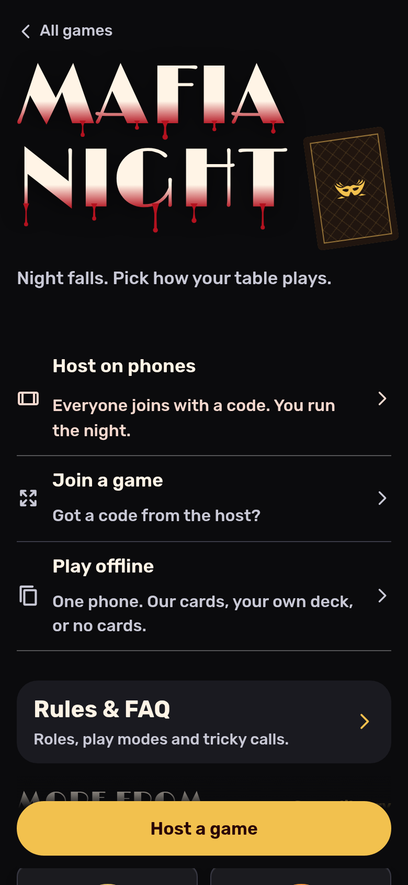
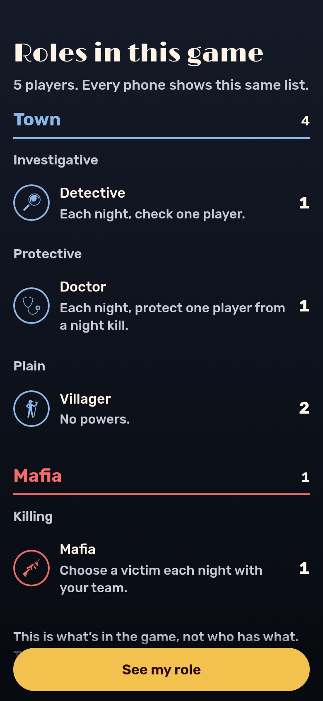
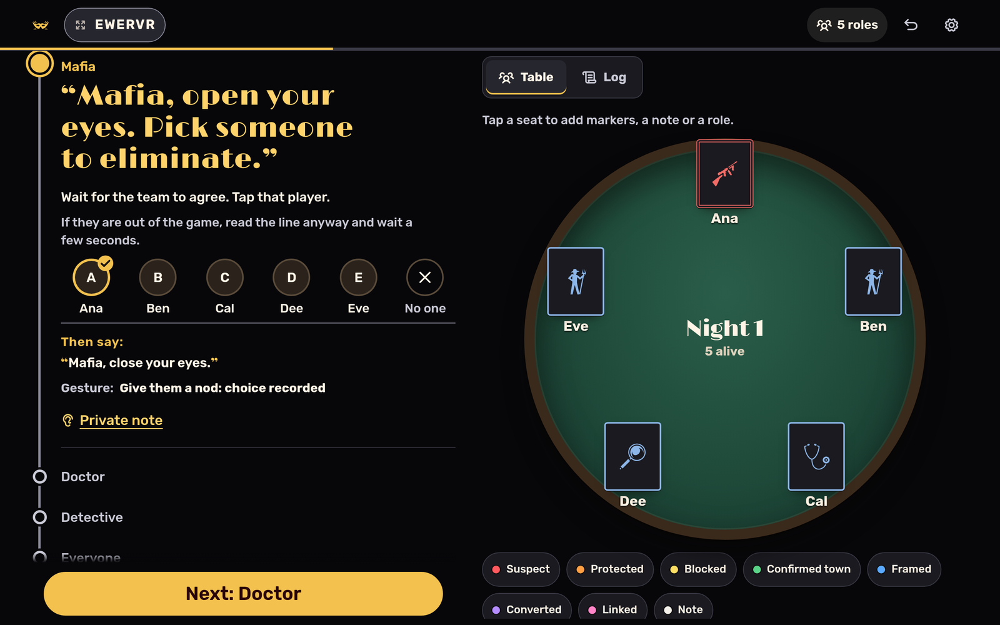

# Mafia Night

Mafia Night is a web app for running an in-person game of Mafia or Werewolf. It deals secret roles to players' phones and gives the host a console that runs the night, resolves actions and calls the winner. It is for groups of 5 to 50 players at a table. A Cloudflare Durable Object holds each room and is the only source of truth. Each phone gets a projection of that room that shows only what its player may see. The app installs as an offline PWA, and a suite of over 2,500 unit tests, including rule checks across hundreds of simulated games, guards the rules and the secrets.

**Live:** https://mafia.hatethespurs.com

<p>
  
  
</p>


## Features

- **Three ways to deal.** Phones join a room with a 6-letter code or QR code, with no login. A playing-card key lets a real deck stand in for role cards. "Run on this device" plays the whole game on one screen with no server.
- **Host console.** It gives the night script in role order and resolves kills, protects, jails, blocks, frames, conversions and investigations. It writes a morning report with private lines for the host to pass on. It also checks town, mafia, serial killer and cult wins, plus side wins such as Jester and Executioner.
- **Undo and redo.** Every change is an event in an append-only log, so the host can undo and redo from any phone. The room server can also change an earlier step and keep the steps after it (no UI for this yet).
- **184 built-in roles**, plus an in-app role editor. Custom roles are checked on the server before a room accepts them.
- **Seating board** with player notes, role corrections and eliminate or revive.
- **Graveyard chat** for dead players and the host. The server sends it only to them.
- **Printable guide** (`/print.html`) with the card key, setup steps, a night script and cut-out role cards.
- **Installable and offline.** A web manifest and service worker let it work with no connection once it has been opened.

## Stack

- **Language:** JavaScript (ES modules). No build step for the client.
- **Server:** Cloudflare Workers. One Durable Object per room, SQLite-backed, using the WebSocket Hibernation API. Static files come from Workers Static Assets.
- **Client:** vanilla JS, HTML and CSS. No framework.
- **PWA:** `manifest.webmanifest` and a service worker (`sw.js`) whose cache version is a content hash of `public/`.
- **Assets:** role icons from game-icons.net, interface icons from Phosphor, self-hosted subset fonts. A small QR encoder written in-house.
- **Tooling:** Wrangler 4, `node --test`, Playwright for multi-phone browser tests.

## How it works

```
src/worker.js          Worker routes (/api/create, /ws/<code>) + Room Durable Object
public/js/engine.js    pure game rules: night order, resolution, win checks
public/js/room.js      room reducer and per-viewer projections (the secrecy lives here)
public/js/event-log.js the room as an event log: room = replay(base, events)
public/js/roles*.js    role catalog and custom-role validation
public/js/app.js       client entry; host.js and player.js render each side
```

- The same `engine.js` and `room.js` run in the Durable Object, in the browser (for local games) and in tests.
- The host and players send moves over a WebSocket. The room applies them and sends each socket its own view. A player only gets their own role (plus teammates for team roles such as Mafia).
- Randomness and time come from each event, so replaying the log rebuilds the same room. That is what makes undo, redo and past-step edits safe.
- One room per code (`idFromName`). State persists on every action. An alarm deletes the room after 12 hours with no activity.

## Run locally

Requires Node 22 or newer.

```bash
npm ci
npm run dev        # http://localhost:8787 (wrangler dev --local, no Cloudflare login)
```

## Tests

```bash
npm test           # 2,565 unit tests (node --test), about 20 seconds
npm run e2e        # multi-phone browser test; starts wrangler dev on a free port
BASE=http://localhost:8787 node scripts/live-smoke.mjs                 # end-to-end + secrecy check
BASE=http://localhost:8787 GAMES=50 SEED=1 node scripts/sim-games.mjs  # 50 simulated online games
```

The unit tests include rule checks that play hundreds of full games in-process. The browser tests in `test/e2e/` use `playwright-core` and Chrome. Set `PW` to the `playwright-core` module path and `CHROME` to the browser binary if they are not at the default paths. Set `BASE` to run against a deployed site.

## Deploying

The GitHub Actions workflow `.github/workflows/deploy.yml` runs only when started by hand. It runs the tests, deploys with Wrangler and then runs a live smoke test. It needs `CLOUDFLARE_API_TOKEN` and `CLOUDFLARE_ACCOUNT_ID` as repo secrets. See [docs/deploying.md](docs/deploying.md) for notes and gotchas.

## Credits

- Role icons: [game-icons.net](https://game-icons.net) by Lorc, Delapouite and contributors, [CC BY 3.0](https://creativecommons.org/licenses/by/3.0/).
- Interface icons: [Phosphor](https://phosphoricons.com), MIT.
- Fonts: Rubik and Limelight (shipped as a subset named "Mafia Deco"), plus Alegreya Sans for print, all SIL Open Font License. See [scripts/fonts/README.md](scripts/fonts/README.md).
- Some roles take ideas from the wider Mafia and EpicMafia community, written in our own words.
