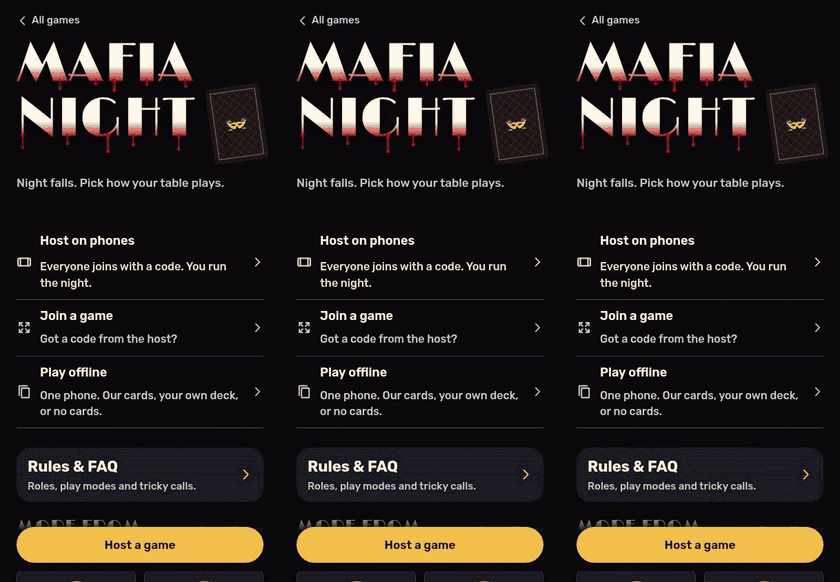

# Mafia Night

A web app that runs an in-person game of Mafia or Werewolf: it deals secret roles to each player's phone and gives the host a console for the night. Built for groups of 5 to 50 at one table.

**Play it: [mafia.hatethespurs.com](https://mafia.hatethespurs.com)**
&nbsp;
[](https://mafia.hatethespurs.com)


<p align="center">
  
</p>

## Features

- **Join with a code.** Players join a room on their own phones with a 6-letter code or QR code. No accounts, no login.
- **Secret roles.** Each phone shows only its own role, behind a hold-to-reveal card that hides again after 3 seconds. Mafia see their teammates; nobody else does.
- **Host console.** The host gets the night script in role order. The app resolves kills, protects, jails, blocks, frames, conversions and investigations, writes the morning report and calls the winner.
- **Undo and redo.** The room is an append-only event log, so the host can step back and forward from any phone.
- **184 built-in roles** plus an in-app role editor. The server validates custom roles before a room accepts them.
- **Three ways to deal.** Phones, a real deck of playing cards with an on-screen key, or one shared device with no server.
- **Extras for the table.** Seating board with notes, graveyard chat for dead players, and a printable guide with cut-out role cards.
- **Installable and offline.** A web manifest and service worker let it run with no connection once opened.

## Stack

- JavaScript (ES modules), vanilla HTML and CSS. No framework and no client build step.
- Cloudflare Workers, with one SQLite-backed Durable Object per room and the WebSocket Hibernation API.
- Workers Static Assets for the client; a PWA service worker whose cache version is a content hash of `public/`.
- Tests with `node --test`; multi-phone browser tests with Playwright and Chrome.
- Wrangler 4 for local dev and deploys.

## Run locally

Requires Node 22 or newer.

```bash
npm ci
npm run dev        # http://localhost:8787 (wrangler dev --local, no Cloudflare login needed)
```

## Tests

```bash
npm test           # 2,565 unit tests (node --test), about 20 seconds
npm run e2e        # multi-phone browser test; starts wrangler dev on a free port
```

The unit tests include rule checks that play hundreds of full games in-process. The browser tests in `test/e2e/` drive several phones at once with `playwright-core` and Chrome. Set `PW` to the `playwright-core` module path and `CHROME` to the browser binary if they are not at the default paths, and set `BASE` to run against a deployed site.

More checks against a running server:

```bash
BASE=http://localhost:8787 node scripts/live-smoke.mjs                 # end-to-end and secrecy check
BASE=http://localhost:8787 GAMES=50 SEED=1 node scripts/sim-games.mjs  # 50 simulated online games
```

## Project structure

```
src/worker.js            Worker routes (/api/create, /ws/<code>) and the Room Durable Object
public/index.html        the app shell; print.html is the printable guide
public/js/engine.js      pure game rules: night order, resolution, win checks
public/js/room.js        room reducer and per-viewer projections (the secrecy lives here)
public/js/event-log.js   the room as an event log: room = replay(base, events)
public/js/roles*.js      role catalog and custom-role validation
public/js/app.js         client entry; host.js and player.js render each side
public/sw.js             service worker for offline play
test/                    unit tests (node --test)
test/e2e/                multi-phone browser tests
scripts/                 asset builds, live smoke test, game simulator
docs/                    architecture and deploy notes
```

The same `engine.js` and `room.js` run in the Durable Object, in the browser for single-device games, and in tests. Phones send moves over a WebSocket; the room applies them and sends each socket only the view its player may see. Randomness and time are stored in each event, so replaying the log rebuilds the same room, which is what makes undo and redo safe. See [docs/architecture.md](docs/architecture.md) for more.

## Deploying

A manual GitHub Actions workflow (`.github/workflows/deploy.yml`) runs the tests, deploys with Wrangler and runs a live smoke test. It needs `CLOUDFLARE_API_TOKEN` and `CLOUDFLARE_ACCOUNT_ID` as repo secrets. See [docs/deploying.md](docs/deploying.md).

## More screenshots

<p>
  
  
  
</p>

## Credits

- Role icons: [game-icons.net](https://game-icons.net) by Lorc, Delapouite and contributors, [CC BY 3.0](https://creativecommons.org/licenses/by/3.0/).
- Interface icons: [Phosphor](https://phosphoricons.com), MIT.
- Fonts: Rubik and Limelight (shipped as a subset named "Mafia Deco"), plus Alegreya Sans for print, all SIL Open Font License. See [scripts/fonts/README.md](scripts/fonts/README.md).
- Some roles take ideas from the wider Mafia and EpicMafia community, written in our own words.
